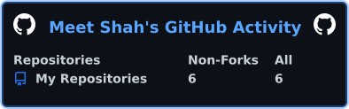
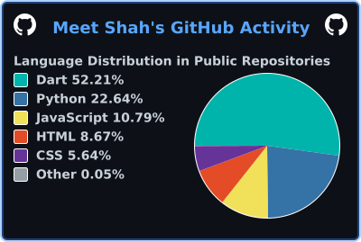
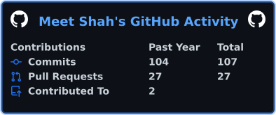

<!--
  GitHub Profile README for Meet Shah
  Repository name: meetrshah2112
-->
  
  

    
    
  
  <h3>Software Developer · Backend · Full Stack · Data & AI</h3>
  

    I build backend systems, web applications, and data-driven products. 
    I enjoy turning complex ideas into practical, well-structured software.
  

What I build
<table>
  <tr>
    <td width="50%">
      <h3>Backend & APIs</h3>
      Designing REST APIs, application logic, database-backed services, and integrations.
    </td>
    <td width="50%">
      <h3>Full-stack products</h3>
      Building responsive interfaces connected to reliable backend systems.
    </td>
  </tr>
  <tr>
    <td width="50%">
      <h3>Data & AI</h3>
      Exploring data processing, analysis, machine learning, and forecasting workflows.
    </td>
    <td width="50%">
      <h3>Systems & infrastructure</h3>
      Working with Docker, distributed storage concepts, cloud tools, and automation.
    </td>
  </tr>
</table>Selected projects
Project	What it does	Core technologies
Shardize — Decentralized Storage	A decentralized storage prototype using IPFS nodes, encrypted files, chunking, metadata, and file reconstruction.	Python, Django, IPFS/Kubo, React, SQLite
ErgoSpace	A workspace discovery and booking platform with location-based search, provider and customer flows, and payment integration.	Python, Django, PostgreSQL, React, Docker, Razorpay
Money Mentor	A personal finance application for expense tracking, stock trend forecasting, tax comparison, and goal-based planning.	Flutter, Flask, Firebase, Python, ARIMA

Technology stack
Languages

  

Frameworks & development

  

Databases & infrastructure

  

Data, analytics & AI

  
  
  
  
  
  
  
  
  
  

GitHub activity

  

    
    
  
  
These SVG cards are generated automatically by GitHub Actions and stored in this repository. They refresh daily.

  Build. Learn. Improve. Repeat.

  <a href="https://github.com/meetrshah2112">GitHub</a>
 · 
<a href="https://www.linkedin.com/in/meetshah2005/">LinkedIn</a>

